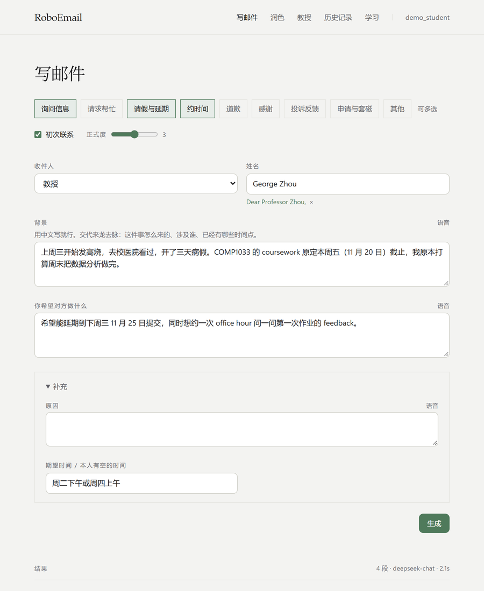
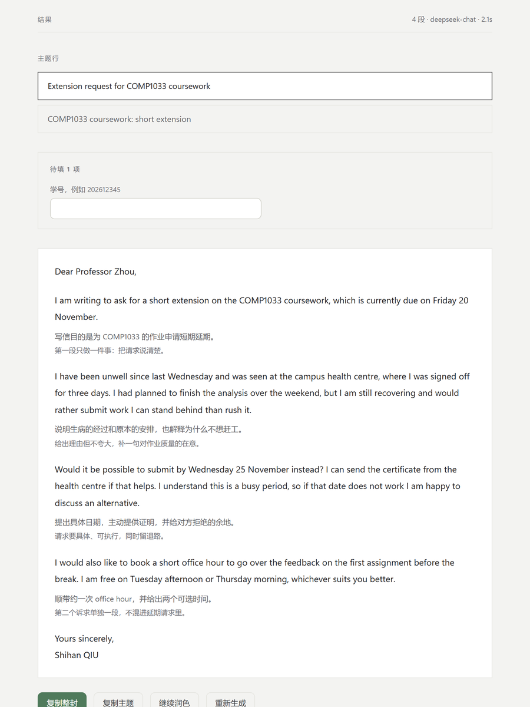
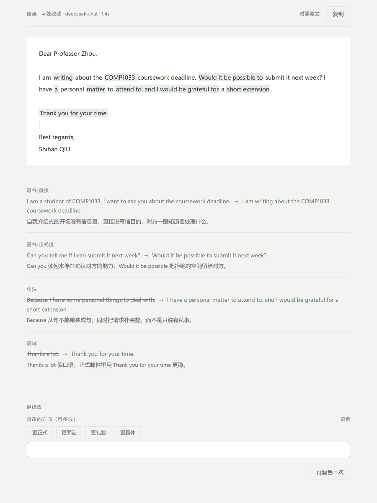
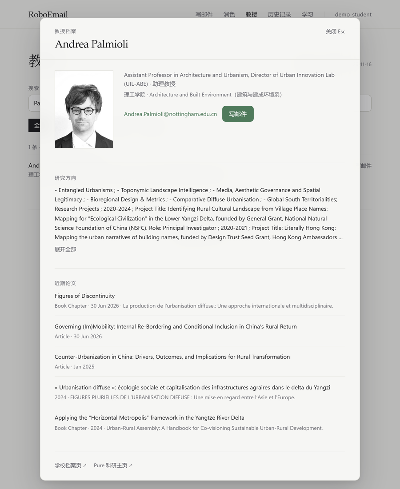
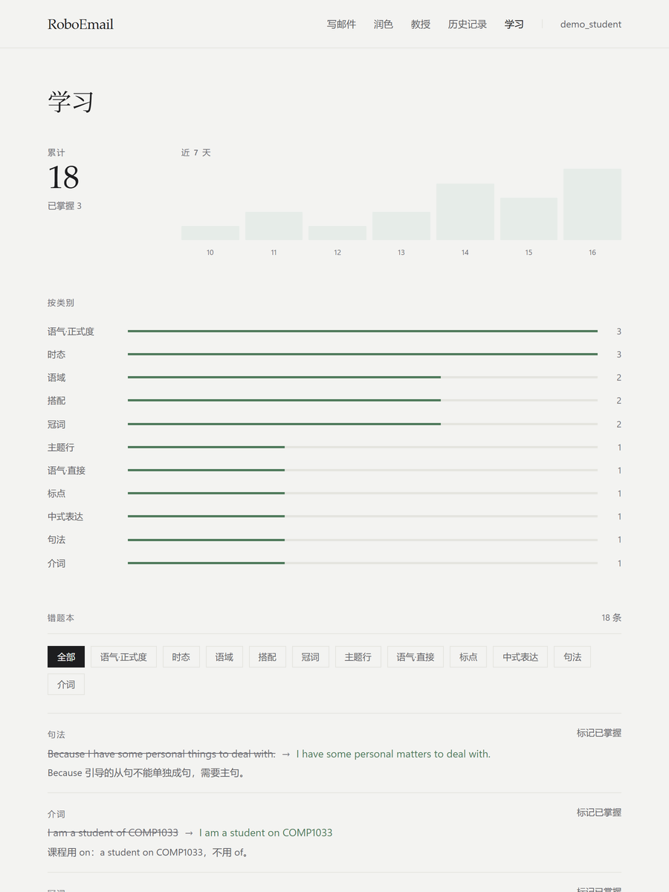
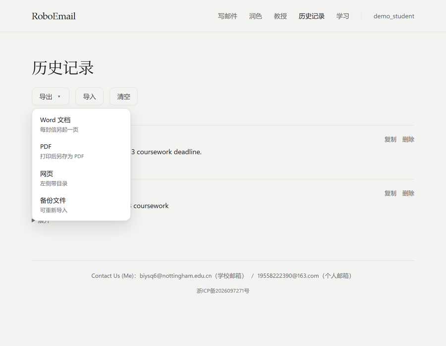
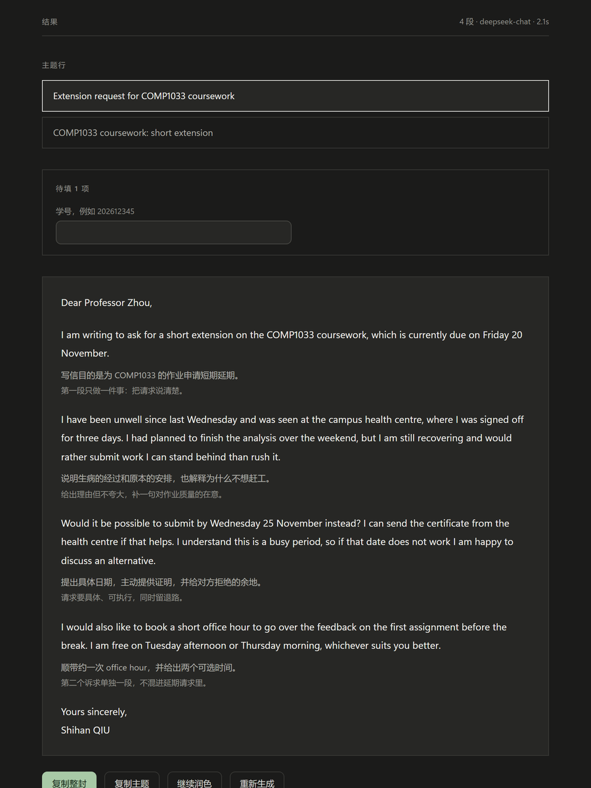
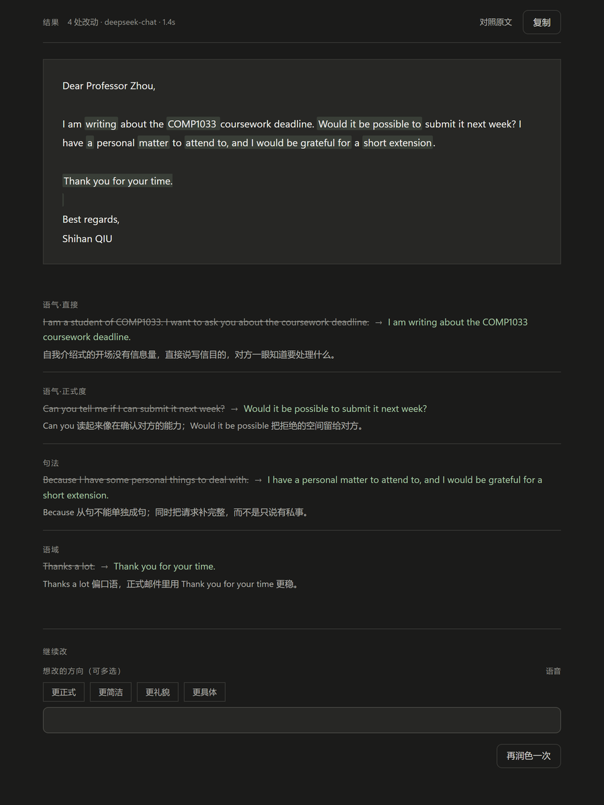
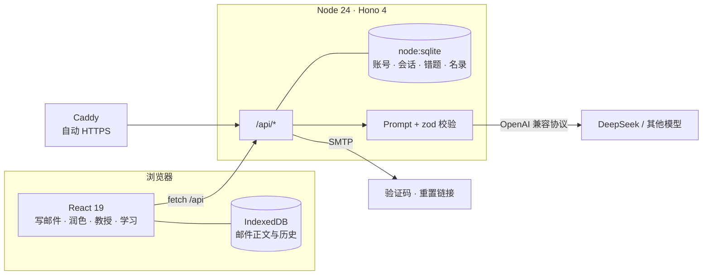

<div align="center">

<picture>
  <source media="(prefers-color-scheme: dark)" srcset="docs/assets/banner-dark.svg" />
  
</picture>

<br />

<picture>
  <source media="(prefers-color-scheme: dark)" srcset="docs/assets/tagline-dark.svg" />
  
</picture>

<br />

<a href="https://rbem.online"></a> <a href="https://github.com/Sherry-Qiuu/RoboEmail/stargazers"></a> <a href="https://github.com/Sherry-Qiuu/RoboEmail/commits/main"></a>      

<br />

<a href="https://rbem.online"><b>在线使用</b></a> · <a href="#界面">界面</a> · <a href="#功能">功能</a> · <a href="#架构">架构</a> · <a href="#快速开始">快速开始</a> · <a href="#部署">部署</a> · <a href="docs/PRD.md">PRD</a>

</div>

---

## 这是什么

> **写给教授的英文邮件，从提笔到收尾。**
>
> 对中文母语的学生来说，写英文邮件的难点从来不是语法，而是不知道英国学术场合该怎么说话：称呼用 Professor 还是 Dr，求助怎么开口才不显得理所当然，催进度怎么催才不冒犯。

RoboEmail 不是翻译器，也不是通用写作 AI。它只做一件事：让这封信读起来像英国校园里该有的样子。

它把这件事拆成两条路：

| 还没动笔 | 已经写好 |
| --- | --- |
| 选目的、用中文写背景，直接得到一版措辞得体的英式邮件，附带中文对照和每段的用意。 | 贴英文草稿，拿回改过的版本、逐条改动理由，以及你真正写错的地方。 |

两条路都通向同一个结果区：可对照、可复制、可继续改、可留在历史里。

<details>
<summary><b>目录</b></summary>

- [这是什么](#这是什么)
- [界面](#界面)
- [功能](#功能)
- [架构](#架构)
- [技术栈](#技术栈)
- [数据](#数据)
- [快速开始](#快速开始)
- [命令](#命令)
- [部署](#部署)
- [几条边界](#几条边界)
- [已知限制](#已知限制)
- [文档](#文档)
- [联系](#联系)

</details>

---

## 界面

> 截图来自本地演示账号，邮件与错题内容均为示例数据；深色模式截图附在本节末尾。

<p align="center">
  
  <br />
  <sub>写邮件 —— 目的可多选；姓名从教授库带出，称呼自动变成 <code>Dear Professor Zhou,</code></sub>
</p>

<p align="center">
  
  <br />
  <sub><b>生成结果</b> —— 2–3 个主题行、待填槽位、段落中英对照与写作说明</sub>
</p>

<p align="center">
  
  <br />
  <sub><b>润色结果</b> —— 改动高亮、<code>before → after</code>、每处改动的中文理由</sub>
</p>

<table>
  <tr>
    <td width="50%" valign="top">
      
      <br />
      <sub><b>教授档案</b> —— 照片、职称、研究方向、近期论文（DOI / Pure）</sub>
    </td>
    <td width="50%" valign="top">
      
      <br />
      <sub><b>学习</b> —— 近 7 天趋势、分类统计、可标记已掌握的错题本</sub>
    </td>
  </tr>
</table>

<p align="center">
  
  <br />
  <sub>历史与导出 —— 正文只存在浏览器里；Word / PDF / HTML / JSON 四种出口</sub>
</p>

<details>
<summary><b>深色模式</b>（跟随系统，也可在页面里手动切换）</summary>

<br />

<table>
  <tr>
    <td width="50%" valign="top">
      
      <br />
      <sub>生成结果 · 深色</sub>
    </td>
    <td width="50%" valign="top">
      
      <br />
      <sub>润色结果 · 深色</sub>
    </td>
  </tr>
</table>

</details>

---

## 功能

### 写邮件：从一句中文背景开始

- **目的可多选**：询问信息、请求帮忙、请假与延期、约时间、道歉、感谢、投诉反馈、申请与套磁、其他。一封邮件同时做两件事也行。
- **背景用中文写**：交代来龙去脉即可，不用先想英文句子。
- **称呼自动推导**：从教授库选人，按英国惯例给 `Professor` 或 `Dr`；行政人员用全名。
- **不编造事实**：你没有提供的信息不会凭空出现，缺的地方留 `{{student_id}}` 这样的命名槽位并高亮提示替换。
- **英式写作约束**：英式拼写、不用 "I hope this email finds you well" 开头、请求里给对方留拒绝的余地。
- **语音输入**：背景、诉求、原因都可以直接说（Web Speech API，不支持时按钮隐藏）。
- **结果可交付**：主题行单独给 2–3 个备选；复制整封或只复制主题；一键「继续润色」。

### 润色：改得对，并且讲清楚为什么

- **英英润色**：输入英文草稿，输出英文成稿，不做中英互译。
- **逐条理由**：每一处改动都给出 `before → after` 和一句中文解释，不是甩一版新文本。
- **方向可组合**：更正式 / 更简洁 / 更礼貌 / 更具体，可多选叠加，再写一句自己的要求，例如「别太卑微，强调截止日期」。
- **可以一直改**：拿到结果后继续下一轮，第一次和后续每一轮用同一套方向设置。
- **20 类错误标签**：时态、冠词、搭配、中式表达、语气·直接 / 卑微 / 正式度、主题行、称呼、落款……
- **新增事实检测**：服务端用数字和日期正则比对原文与改后文本，改后出现原文没有的内容会提醒确认；这一步不交给模型自查。

### 教授、学习、历史

- **教授库**：576 位教职工，按三院筛选、按姓名或邮箱搜索；点开是档案卡，含照片、研究方向、近期论文和学校档案页。只对勾选「我是 UNNC 学生」的账号开放，可随时在教授页开启。
- **学习**：润色改出的真实语言错误自动归档，按 20 类统计，配近 7 天柱状图和错题本；可筛选、可标记已掌握。纯风格改写不进错题本。
- **历史**：正文存在浏览器 IndexedDB，服务端不存任何一封信。支持导出 Word（Word 兼容的 `.doc`）、PDF（浏览器打印）、HTML（左侧带目录）、JSON（备份与重新导入）。

> 两个模式共用同一条底线：**只改语言，不改事实。** 润色会标出模型新加的数字与日期；生成没信息可写时留槽位，而不是编一个。

---

## 架构



几个关键决定：

| 决定 | 为什么 |
| --- | --- |
| 正文只进 IndexedDB | 服务端不保存信，泄露面只剩账号信息和被改出的错误片段 |
| 服务端零构建 | Node 24 直接运行 `.ts`（类型剥离），`node:sqlite` 免原生编译 |
| 模型输出先过 zod | 模型返回的 JSON 不可信，形状不对就返回 502，而不是把坏数据塞进界面 |
| 新增事实用正则兜底 | 让模型检查自己有没有幻觉，不算检查 |
| 称呼由数据推导 | 职称表决定 `Professor` / `Dr` / 全名，不靠模型猜 |

## 技术栈

| 层 | 选择 | 说明 |
| --- | --- | --- |
| 前端 | React 19 · Vite 8 · Tailwind 4 | 单页应用，无路由库；构建产物由 API 静态托管 |
| 外观 | Edge Fluent appearance runtime | 深浅色 / 跟随系统，5 套配色与 10 套图像主题，全部走 CSS 变量 |
| 服务端 | Node 24 · Hono 4 · zod | 直接运行 TypeScript；服务端没有构建步骤 |
| 存储 | `node:sqlite` | 账号、会话、验证码、错题、教授名录都在一个文件里 |
| 模型 | OpenAI 兼容协议 | 默认 DeepSeek，可换任意兼容服务；不填 key 走内置 mock |
| 邮件 | SMTP（本地回落到控制台） | 6 位验证码与重置链接；开发环境零配置 |
| 部署 | Docker Compose · Caddy | 自动 HTTPS；应用端口不对公网开放，只能经 Caddy |

## 数据

| 数据 | 数量 | 位置 |
| --- | --- | --- |
| 教职工名录 | 576 人 | `apps/server/data/professors.json` → SQLite（启动时自动播种） |
| 教授档案 | 463 份 | `apps/server/assets/profiles.json`，请求时按邮箱 / 姓名关联 |
| 照片 | 407 张 · 约 7 MB | `apps/server/assets/photos/`，已压缩到 420px |
| 论文 | 1420 篇 | 随档案返回，优先链 DOI，没有则链 Pure 页面 |

更新方式：

```bash
python scripts/xlsx_to_professors.py   # 三个 Excel -> professors.json
node scripts/import_professors.mjs     # JSON -> SQLite
python scripts/import_profiles.py      # 三院教师主页 -> apps/server/assets/
```

> 照片与文字版权归宁波诺丁汉大学所有，仅供校内教学、行政与联络使用。

## 快速开始

需要较新的 Node：服务端依赖 Node 的类型剥离直接运行 `.ts`，数据库用 `node:sqlite`。**推荐 Node 24**；更旧的版本可能不认识 `.ts`，也可能没有 `node:sqlite`。

```bash
git clone https://github.com/Sherry-Qiuu/RoboEmail.git
cd RoboEmail
pnpm install
pnpm dev
```

打开 http://localhost:5173 。

**不填任何密钥也能跑通全部界面**：

| 变量留空 | 行为 |
| --- | --- |
| `LLM_API_KEY` | 走内置 mock 模型，不联网、不计费 |
| `SMTP_HOST` | 验证码打印到服务端日志，注册流程照样走完 |

Windows 上双击根目录的 `start.cmd` 也可以，它会自动装依赖并打开浏览器。

<details>
<summary>不用 pnpm？</summary>

```bash
npm install
npm run dev:server   # 一个窗口
npm run dev:web      # 另一个窗口
```

切换包管理器前先删掉 `node_modules`，两者不要混用。Windows 请在 **cmd** 里执行，PowerShell 会把 `rmdir` 映射成别的命令。

</details>

<details>
<summary>pnpm 提示 ERR_PNPM_IGNORED_BUILDS？</summary>

pnpm 11 默认不执行依赖的安装脚本，会把 esbuild 的 postinstall 当成错误。依赖其实已经装好，按提示执行一次 `pnpm approve-builds` 允许 esbuild 即可；Docker 构建里用的是 `--ignore-scripts`，不依赖这一步。

</details>

## 命令

| 命令 | 作用 |
| --- | --- |
| `pnpm dev` | 前后端一起起 |
| `pnpm dev:server` | 只起 API（`node --watch`） |
| `pnpm dev:web` | 只起 Vite |
| `pnpm build` | 构建前端到 `apps/web/dist` |
| `pnpm check` | 前端所有模块的语法检查 |
| `pnpm smoke` | 端到端回归，临时数据库，31 项检查 |
| `pnpm test:export` | 导出格式的离线检查 |
| `pnpm verify:live` | 从本机检查线上：端口、证书、接口、备案号 |

## 版本

版本号写在根目录 `package.json` 的 `version`，前端构建和服务端 `/api/health` 都读这一个字段。

发版三步：

1. 改 `package.json` 的 `version`
2. 在 [`apps/web/src/changelog.ts`](apps/web/src/changelog.ts) 顶部加一条（访客打开网页时看到的就是它）
3. 在 [`CHANGELOG.md`](CHANGELOG.md) 顶部加一节

弹窗按版本号判断：浏览器 `localStorage` 记着上次看过的版本，对不上才弹一次。

## 部署

Docker Compose + Caddy，一台 2C2G 的轻量服务器够用。Caddy 独占 80/443 并自动续证书，应用容器不对外发布端口。

```bash
git pull
docker compose up -d --build
node scripts/verify-live.mjs
```

改完 `.env` 必须 `docker compose up -d --force-recreate app`，`restart` 不会重新读取环境变量。

完整流程（买服务器 → 配 DNS → 备案 → 起服务 → 第二站点）见 [`docs/deploy.md`](docs/deploy.md)，同机双站的分工见 [`docs/handoff-two-site.md`](docs/handoff-two-site.md)。

## 反馈

结果页有一行「这次结果有用吗」，页脚有「反馈」入口。文字建议存进 `feedback` 表，界面里没有后台——用命令行看：

```bash
node scripts/feedback.mjs            # 最近 20 条
node scripts/feedback.mjs --unread   # 只看没处理的
node scripts/feedback.mjs --done <id> # 标记已处理
```

在 `.env` 里填 `FEEDBACK_EMAIL=你的邮箱`，收到文字建议时会同时发一封信；不填就只入库。

## 几条边界

- **邮件正文不落库。** 服务端不保存任何一封信，只保存被改出的错误片段（`before` / `after` / 中文解释 / 类别）。调用模型时正文会发给所配置的模型服务，这是生成与润色的前提；服务端自己不留副本。
- **必须先登录。** 打开网站就是登录页，没有匿名通道；注册要过邮箱验证。
- **不编造事实。** 模型只能使用你给的信息，缺什么留占位符；润色新增的数字和日期会被单独标出来。
- **称呼要准。** 英国学术习惯下，只有正教授是 `Professor`，副教授与助理教授是 `Dr`。
- **有配额与限流。** 每个账号每天 30 次模型调用；登录 15 分钟内最多 5 次尝试，验证码最多试 5 次。
- **使用范围。** 仓库未附 LICENSE，代码默认保留所有权利；教授照片与名录版权归宁波诺丁汉大学，仅供校内使用。

## 已知限制

- 服务端依赖 Node 自带的类型剥离和 `node:sqlite`，需要较新 Node；好处是零构建、无原生编译。
- 历史记录存在浏览器里，换设备不会跟过去，用 JSON 导出 / 导入带走。
- Word 导出是 Word 兼容的 `.doc`（HTML 内嵌），不是真正的 `.docx`；PDF 走浏览器打印对话框。
- 教授档案覆盖 463 / 576 人，不是每个人都有照片或论文；没有档案的人仍可按名录里的邮箱联系。
- 「学习」只收真实语言错误，纯风格改写不进错题本——草稿本来就干净时，那里会是空的。
- 模型质量取决于所接的 provider；mock 模式只用来跑通界面，不产生真实邮件。

## 文档

| 文件 | 内容 |
| --- | --- |
| [`docs/PRD.md`](docs/PRD.md) | 需求、边界、数据归属的取舍 |
| [`docs/usage.md`](docs/usage.md) | 使用说明与运维命令 |
| [`docs/deploy.md`](docs/deploy.md) | 从买服务器到上线的完整流程 |
| [`docs/handoff.md`](docs/handoff.md) | 交接：谁做了什么、哪里容易踩坑 |
| [`docs/handoff-two-site.md`](docs/handoff-two-site.md) | 同机双站的分工与边界 |
| [`docs/two-site-after-filing.md`](docs/two-site-after-filing.md) | 第二站点备案通过后的收尾清单 |
| [`docs/handoff-mailer.md`](docs/handoff-mailer.md) | 发信模块的交接说明 |
| [`docs/video-script.md`](docs/video-script.md) | 宣传视频脚本（90 秒 + 30 秒） |
| [`CHANGELOG.md`](CHANGELOG.md) | 版本更新日志 |

## 联系

- 学校邮箱：[biysq6@nottingham.edu.cn](mailto:biysq6@nottingham.edu.cn)
- 在线使用：[rbem.online](https://rbem.online)

如果它帮你少改了一次称呼，点个 Star 就行；发现写错的地方，欢迎开 Issue。

<div align="center">

<br />

<sub>校内使用 · 照片与文字版权归宁波诺丁汉大学所有 · 浙ICP备2026097271号</sub>

</div>
