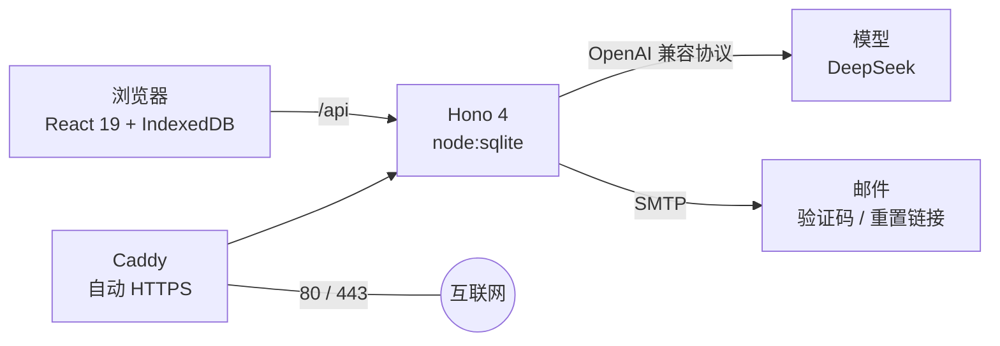

<p align="center">
  
</p>

<p align="center">
  <b>写给教授的英文邮件，从提笔到收尾</b><br />
  <sub>UNNC 学生在用的英文邮件写作助手 · <a href="https://rbem.online">rbem.online</a></sub>
</p>

<p align="center">
  <a href="https://rbem.online"></a>
  
  
  
  
  
</p>

---

## 这是什么

写英文邮件对中文母语的学生来说，难点不在语法，在于**不知道英国学术场合该怎么说话**：称呼用 Professor 还是 Dr，求助怎么开口才不显得理所当然，催进度怎么催才不冒犯。

RoboEmail 把这件事拆成两条路：

- **没动笔**：选目的、写背景（中文就行），直接得到一版措辞得体的英式邮件，附带中文对照和每段的用意
- **写好了**：贴草稿，拿回改过的版本、逐条改动理由，以及你真正写错的地方

它不是翻译器，也不是通用写作 AI。它只做一件事：让这封信读起来像英国校园里该有的样子。

---

## 界面

<p align="center">
  
  <br />
  <sub>点教授列表里的任意一行，弹出档案卡：照片、研究方向、近期论文（链到 DOI 或 Pure 科研页）</sub>
</p>

---

## 功能

<details open>
<summary><b>✍️ 写邮件</b></summary>

- **目的可多选**：询问信息、请求帮忙、请假与延期、约时间、道歉、感谢、投诉反馈、申请与套磁。一封邮件同时做两件事也行
- **背景用中文写**：交代来龙去脉即可，不用先想英文句子
- **称呼自动推导**：从教授库选人，按英国惯例给 Professor 或 Dr
- **不编造事实**：你没有提供的信息不会凭空出现，缺的地方留 `{{占位符}}` 并高亮提示替换
- **语音输入**：背景和诉求都可以直接说

</details>

<details open>
<summary><b>🖊️ 润色</b></summary>

- **英英润色**：输入英文草稿，输出英文成稿，不做中英互译
- **逐条理由**：每一处改动都说明为什么改，不是甩一版新文本给你
- **方向可组合**：标签（更正式 / 更简洁 / 更礼貌 / 更具体，可多选）叠加自由输入，比如「别太卑微，强调截止日期」
- **可以一直改**：拿到结果后继续下一轮，第一次和后续每一轮用的是同一套方向设置

</details>

<details open>
<summary><b>🎓 教授与学习</b></summary>

- **576 位教职工名录**：按院系筛选、按姓名搜索
- **463 份档案**：照片、研究方向、近期论文，407 人有照片，1420 篇论文可跳转
- **学习页**：润色改出的真实语言错误按类别归档，可筛选、标记已掌握，附统计

</details>

<details open>
<summary><b>🗂️ 历史与账号</b></summary>

- 历史记录存在**浏览器本地**，服务端不存正文
- 导出 **Word / PDF / HTML / JSON**：Word 和 PDF 每封信另起一页，HTML 左侧带书签目录，JSON 用于备份与导入
- 邮箱验证注册、忘记密码走邮件链接、设置页改密码（两次确认）

</details>

---

## 快速开始

需要 Node 22.6 以上（推荐 24）。

```bash
git clone https://github.com/Sherry-Qiuu/RoboEmail.git
cd RoboEmail
pnpm install
pnpm dev
```

打开 http://localhost:5173

**不填任何密钥也能跑通全部界面**：

| 变量留空 | 行为 |
| --- | --- |
| `LLM_API_KEY` | 走内置 mock 模型，不联网、不计费 |
| `SMTP_HOST` | 验证码打印到服务端日志，注册流程照样走完 |

Windows 上双击根目录的 `start.cmd` 也可以，它会自动装依赖并打开浏览器。

<details>
<summary>不用 pnpm？</summary>

```bash
npm install
npm run dev:server   # 一个窗口
npm run dev:web      # 另一个窗口
```

切换包管理器前先删掉 `node_modules`，两者不要混用。Windows 请在 **cmd** 里执行，PowerShell 会把 `rmdir` 映射成别的命令。

</details>

---

## 架构



- **正文不出浏览器**：历史存在 IndexedDB，服务端只保存账号信息和被改出的错误片段
- **服务端没有构建步骤**：Node 24 直接运行 `.ts`（类型剥离），`node:sqlite` 免编译原生模块
- **两个站共用一台机器**：Caddy 独占 80/443，按域名分流

---

## 数据

| 数据 | 数量 | 存放 |
| --- | --- | --- |
| 教职工名录 | 576 人 | `apps/server/data/professors.json` → SQLite（启动时自动播种） |
| 教授档案 | 463 人 | `apps/server/assets/profiles.json`，请求时按邮箱/姓名关联 |
| 照片 | 407 张 · 7 MB | `apps/server/assets/photos/`，已压缩到 420px |
| 论文 | 1420 篇 | 随档案一起，优先链 DOI，没有则链 Pure 页面 |

更新方式：

```bash
python scripts/xlsx_to_professors.py   # 三个 Excel -> professors.json
node scripts/import_professors.mjs     # JSON -> SQLite
python scripts/import_profiles.py      # 三院教师主页/ -> apps/server/assets/
```

> 照片与文字版权归宁波诺丁汉大学所有，仅供校内教学、行政与联络使用。

---

## 命令

| 命令 | 作用 |
| --- | --- |
| `pnpm dev` | 前后端一起起 |
| `pnpm build` | 构建前端到 `apps/web/dist` |
| `pnpm check` | 前端所有模块的语法检查 |
| `pnpm smoke` | 端到端回归，临时数据库，26 项检查 |
| `pnpm test:export` | 导出格式的离线检查 |
| `pnpm verify:live` | 从本机检查线上：端口、证书、接口、备案号 |

---

## 部署

Docker Compose + Caddy，一台 2C2G 的轻量服务器够了。

```bash
git pull
docker compose up -d --build
node scripts/verify-live.mjs   # 八项检查
```

完整流程（买服务器 → 配 DNS → 备案 → 起服务）见 [`docs/deploy.md`](docs/deploy.md)。

> 改完 `.env` 必须 `docker compose up -d --force-recreate app`，`restart` 不会重新读取环境变量。

---

## 几条边界

- **邮件正文不上云**。服务端不保存任何一封信，只保存被改出的错误片段（`before` / `after` / 中文解释 / 类别）
- **必须先登录**。打开网站就是登录页，没有匿名试用
- **不编造事实**。模型只能用你给的信息，缺什么留占位符
- **称呼要准**。英国学术习惯下，只有正教授是 Professor，副教授和助理教授是 Dr

---

## 已知限制

- 服务端依赖 Node 自带的类型剥离和 `node:sqlite`，需要较新 Node，好处是零构建、无原生编译
- 历史记录存在浏览器里，换设备不会跟过去，用导出/导入带走
- Word 导出是 Word 兼容的 `.doc`（HTML 内嵌），不是真正的 `.docx`；PDF 走浏览器打印对话框
- 「学习」只收真实语言错误，纯风格改写不进错题本——草稿本来就干净时，那里会是空的

---

## 文档

| 文件 | 内容 |
| --- | --- |
| [`docs/PRD.md`](docs/PRD.md) | 需求、边界、数据归属的取舍 |
| [`docs/usage.md`](docs/usage.md) | 使用说明与运维命令 |
| [`docs/deploy.md`](docs/deploy.md) | 从买服务器到上线的完整流程 |
| [`docs/handoff.md`](docs/handoff.md) | 交接：谁做了什么、哪里容易踩坑 |
| [`docs/handoff-two-site.md`](docs/handoff-two-site.md) | 同机双站的分工与边界 |
| [`docs/two-site-after-filing.md`](docs/two-site-after-filing.md) | 第二站点备案通过后的收尾清单 |
| [`docs/video-script.md`](docs/video-script.md) | 宣传视频脚本（90 秒 + 30 秒） |

---

<p align="center">
  <sub>校内使用 · 照片版权归宁波诺丁汉大学所有 · 备案号 浙ICP备2026097271号</sub>
</p>
